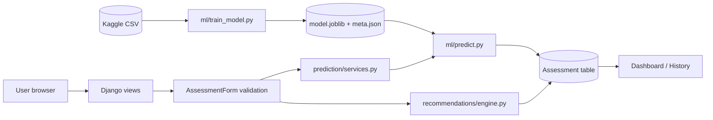

# Architecture

```
OFFLINE (your laptop, run when you want a new model)
  data/heart_2020_cleaned.csv
      -> ml/data.py        load, validate schema, drop NaN/out-of-range/duplicates
      -> split 80/20 (stratified)  --- test set is locked away
      -> ml/train_model.py 5-fold CV on train: 3 algorithms x {none, balanced}
      -> pick best mean CV ROC-AUC; thresholds from out-of-fold scores
      -> single evaluation on test set
      -> model_artifacts/model.joblib  (Pipeline: preprocessing + classifier)
         model_artifacts/model_meta.json (version, features, thresholds, metrics)

ONLINE (Django)
  Browser (Bootstrap 5, Chart.js)
      | HTTPS
      v
  config/urls.py
      |-- accounts/         register, login, logout, profile, delete account
      |-- health/           AssessmentForm -> views -> Assessment model (DB)
      |      |
      |      |-- prediction/services.py -> ml/predict.py -> loads model.joblib ONCE (cached)
      |      |-- recommendations/engine.py (rules, with reasons)
      |
      v
  SQLite (local) / PostgreSQL (Render)
```



## Request flow for one assessment
1. `POST /health/assessment/new/` (login required, CSRF-protected).
2. `AssessmentForm` validates ranges/choices server-side and computes BMI from height and weight.
3. `age_to_category()` converts age to the dataset's age band.
4. `ml.predict.predict_one()` re-validates the 16 model features, runs the pipeline, returns score + category.
   If the model file is missing/unloadable -> `ModelNotAvailableError` -> setup message, nothing saved.
5. `recommendations.engine.generate_recommendations()` builds explained tips.
6. The `Assessment` row stores inputs, score, category, model version, and tips, tied to `request.user`.

## Data model
* `auth.User` 1--1 `accounts.Profile` (optional pre-fill data)
* `auth.User` 1--N `health.Assessment` (inputs + outputs + recommendations JSON + model_version)

Recommendations are stored as JSON inside `Assessment` (they are always read together with it, so a
separate table adds no value) and keep the advice as it was at the time of the assessment.
